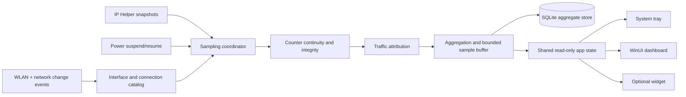

# Windows Network Monitor — Phase 1 Feasibility & Architecture

**Research date:** 2026-11-20

**Status:** Research and architecture proposal only. No Windows application code has been written.

**Repository finding:** The current workspace contains a native macOS Swift app. This document defines a separate Windows product target and does not replace or modify the macOS app.

## Executive recommendation

Build the Windows edition as a separate **WinUI 3 / .NET 10 desktop application**, with one user-session process hosting a UI-independent monitoring core. Use Windows IP Helper counters (`GetIfTable2` / `MIB_IF_ROW2`) as the authoritative passive interface measurement source; use WLAN and network-change events to invalidate cached state and trigger re-queries. Keep all measurements local in SQLite. Do not introduce a Windows Service, packet capture, kernel driver, or per-process traffic tracking in version 1.

Treat **Windows 11 as the primary supported consumer platform**. As of the research date, Windows 10 Home/Pro 22H2 reached end of support on 2025-10-14, while the .NET 10 Windows support matrix limits Windows 10 support to designated Enterprise/LTSC editions. Windows 10 compatibility should therefore be a separately validated Enterprise/LTSC commitment, not a broad “Windows 10” claim. See [.NET Windows installation requirements](https://learn.microsoft.com/en-us/dotnet/core/install/windows?tabs=netcore31), [Windows client lifecycle](https://learn.microsoft.com/en-us/lifecycle/products/windows-10-home-and-pro), and [Windows release health](https://learn.microsoft.com/en-us/windows/release-health/supported-versions-windows-client).

The largest product caveat is **Wi-Fi identity permission**: retrieving BSSID information through WLAN APIs is location-sensitive on current Windows. Core counters and SSID-level operation should work without asking for BSSID/location access. Offer access-point identification as an explicit opt-in with a clear permission explanation.

## 1. Repository and scope audit

The existing project is a macOS Swift application, with Swift sources, a Swift package manifest, macOS assets, documentation, and tests. There is no Windows solution, C# project, or Windows build environment represented in the workspace. The implementation should be created as a sibling project (for example, `Windows/NetworkMonitor.sln`) while keeping the macOS app intact.

This host is macOS. It can support source authoring and static review, but cannot establish Windows runtime behavior, MSIX installation, WLAN event behavior, resource consumption, or hardware compatibility. Those require Windows 11 and supported Windows 10 LTSC/Enterprise test machines. No benchmark or integration result is claimed here.

## 2. Technical feasibility and API choices

| Need | Recommended API | Use and boundary |
|---|---|---|
| Cumulative per-interface bytes | IP Helper `GetIfTable2` + `MIB_IF_ROW2` | Canonical snapshot of interface counters. `InOctets` and `OutOctets` include unicast, broadcast, and multicast octets. Free the returned table with `FreeMibTable`. |
| Read one interface | `GetIfEntry2` | Useful for a targeted refresh; use the full table for periodic all-interface snapshots. |
| Interface metadata/topology | `MIB_IF_ROW2`, `GetIfStackTable` | Use GUID/LUID, media/type/physical-medium flags, operational state, and stack relationships to classify and avoid obvious double counting. No universal vendor-independent proof resolves every tunnel/bridge overlap. |
| Adapter addresses | `GetAdaptersAddresses` | Supplementary adapter/address metadata only; not the primary byte counter. Avoid frequent full address enumeration. |
| Managed interface view | `.NET NetworkInterface` | Useful for UI-friendly descriptions/status and portability of non-counter metadata. Do not mix its semantics with IP Helper counters without validation. |
| Interface changes | `NotifyIpInterfaceChange` | Event invalidation; re-query a complete row/table after notification. Callback rows can be incomplete. |
| General connectivity changes | `.NET NetworkChange` or WinRT `NetworkInformation.NetworkStatusChanged` | Coarse change signal, not traffic measurement. Use to trigger refreshes rather than poll unrelated state. |
| Wi-Fi connection state | Native WLAN API: `WlanRegisterNotification`, `WlanQueryInterface` | ACM notifications indicate association/disconnection changes. Query current state after the event. Notifications do not provide packet-level attribution. |
| Connected SSID | WinRT `WlanConnectionProfileDetails.GetConnectedSsid()` | SSID-only identity path where supported; does not give packet-level attribution and must not be confused with a unique network identity. |
| Wi-Fi BSSID | `WlanQueryInterface(wlan_intf_opcode_current_connection)` | BSSID is returned in current connection attributes, but Windows location/privacy changes require user precise-location consent for BSSID-bearing APIs. Make opt-in and fail gracefully. |
| Startup | Windows App SDK App Lifecycle StartupTask in packaged app | User-logon launch registration. User controls can disable startup; do not repeatedly re-enable it. |
| Tray icon | Shell notification area API (`Shell_NotifyIcon`) | WinUI 3 does not itself supply the classic tray icon. A narrow Win32 interop component can host it and recover after Explorer restart. |

Primary references: [`GetIfTable2`](https://learn.microsoft.com/en-us/windows-hardware/drivers/network/getiftable2), [`MIB_IF_ROW2`](https://learn.microsoft.com/en-us/windows/win32/api/netioapi/ns-netioapi-mib_if_row2), [`GetIfEntry2`](https://learn.microsoft.com/en-us/windows/win32/api/netioapi/nf-netioapi-getifentry2), [IP Helper API](https://learn.microsoft.com/en-us/windows/win32/api/netioapi/), [`NotifyIpInterfaceChange`](https://learn.microsoft.com/en-us/windows/win32/api/netioapi/nf-netioapi-notifyipinterfacechange), [`.NET NetworkChange`](https://learn.microsoft.com/en-us/dotnet/api/system.net.networkinformation.networkchange?view=net-10.0), [`WlanQueryInterface`](https://learn.microsoft.com/en-us/windows/win32/api/wlanapi/nf-wlanapi-wlanqueryinterface), [`WlanRegisterNotification`](https://learn.microsoft.com/en-us/windows/win32/api/wlanapi/nf-wlanapi-wlanregisternotification), [Wi-Fi access and location changes](https://learn.microsoft.com/en-us/windows/win32/nativewifi/wi-fi-access-location-changes), [`GetConnectedSsid`](https://learn.microsoft.com/en-us/uwp/api/windows.networking.connectivity.wlanconnectionprofiledetails), and [Windows notification area](https://learn.microsoft.com/en-us/windows/win32/shell/notification-area).

### Compatibility implications

- `.NET 10` is an LTS release, but its OS matrix matters independently of WinUI 3’s API floor. Windows 11 x64 and ARM64 are the primary targets; test and declare exact supported Windows 11 releases and architectures during Phase 1 implementation planning.
- Windows App SDK supports a broader technical OS range than the .NET 10 runtime. That does not make every combination a supported commercial target. Windows 10 Home/Pro is already out of support; only claim Windows 10 LTSC/Enterprise if the required .NET 10 runtime and chosen stable Windows App SDK version are both supported and tested on those editions.
- Microsoft documentation currently lists Windows App SDK 2.7.0 as a stable release on the research date. Pin a stable version and re-check the support matrix before project creation; do not use a preview release for production.
- ARM64 is technically supported by current Windows/.NET/WinUI paths, but native architecture builds and real-device tests are required before making a performance or support claim.

References: [.NET release lifecycle](https://learn.microsoft.com/en-us/dotnet/core/releases-and-support), [.NET Windows requirements](https://learn.microsoft.com/en-us/dotnet/core/install/windows?tabs=netcore31), [Windows App SDK support matrix](https://learn.microsoft.com/en-us/windows/apps/windows-app-sdk/support), and [Windows App SDK release channels](https://learn.microsoft.com/en-us/windows/apps/windows-app-sdk/release-channels).

## 3. Interface identity and classification

### Identity

Use a stable key based primarily on `InterfaceGuid` where present, with `InterfaceLuid` as a runtime key and the interface index as a short-lived lookup field. Names, aliases, indices, and descriptions are labels, not identities: indices can change after adapter disable/enable, and names can be changed. If a GUID disappears and later returns, reconnect it only when the GUID and compatible metadata agree; otherwise create a new identity and retain the old history.

Store a snapshot of relevant metadata (description, alias, interface type, physical medium, hardware/connector flags, operational status, network GUID when available). Do not persist MAC addresses unless a concrete feature requires them. If needed for a feature, protect or keyed-hash them and disclose it.

### Classification

Retain every discovered adapter row, but assign a **classification plus confidence**, not a brittle binary truth:

- `PhysicalCandidate`: hardware flag and physical medium/type consistent with Wi-Fi/Ethernet, non-loopback, and connected/operational.
- `Logical`: interface has a stack relationship or represents a higher-level logical layer.
- `TunnelOrVPN`: tunnel type or known software/tunnel characteristics.
- `VirtualOrBridge`: software/virtual medium, bridge, Hyper-V/WSL/container-like adapter, or explicit user designation.
- `Loopback`, `Disabled`, `Disconnected`, `Unknown`.

Use `GetIfStackTable` as evidence of lower/higher interface relationships, not a complete taxonomy. Keep user override controls because vendor drivers and virtual networking products differ. Default aggregate should select active physical Wi-Fi/Ethernet candidates and exclude obvious loopback/tunnel/virtual rows. Explain the selected members in the UI. Provide separate physical, logical, and custom-selected views. Do not claim a universal “internet-only” counter.

## 4. Counter, accuracy, attribution, and aggregation model

### Counter sampling

At each sample capture UTC wall time and a monotonic timestamp (`Stopwatch.GetTimestamp()`), then obtain one table snapshot. For each stable interface identity:

`download B/s = max(0, receivedBytesNow - receivedBytesPrevious) / monotonicElapsedSeconds`

`upload B/s = max(0, sentBytesNow - sentBytesPrevious) / monotonicElapsedSeconds`

A decreasing counter, identity replacement, implausible elapsed gap, or suspend/resume boundary invalidates the delta. Do not convert it into a positive number or estimated usage by default. Begin a new baseline and record the interval as invalid/unobserved as appropriate. 64-bit counters make ordinary wrap practically remote; treat observed decreases as reset/discontinuity unless a documented counter width and plausible rollover can be established. This is safer than assuming rollover.

The counters are interface octets, not application payload bytes, not a billable ISP meter, and not a guarantee of internet-only traffic. They include broadcast/multicast. VPNs and virtual switches can expose overlapping bytes at multiple layers.

### Wi-Fi profile attribution

Keep interface identity separate from network-profile identity:

- `NetworkProfileId`: app-owned stable UUID with user-visible label and optional SSID metadata.
- `AccessPointId`: per-profile opaque token derived from BSSID only when the user opted into BSSID access.
- `InterfaceId`: stable adapter identity from the IP Helper metadata.
- `SessionId`: one observed association period tied to profile/access point/interface.

Do not use SSID alone as a unique ID. In default privacy mode, group by an app-owned profile seeded from SSID plus user confirmation, mark ambiguity when identical SSIDs are encountered, and allow rename/split/merge. For AP differentiation, request BSSID access explicitly; store only a keyed hash (HMAC) using a random per-user install secret protected with Windows user-scope DPAPI/Credential Locker. Do not store raw BSSID. Do not access saved credentials or perform scans.

Subscribe to WLAN ACM state events and interface/path change events. On notification, take a counter snapshot, query connection identity, then take a new baseline as the transition settles. Since notifications and counters are asynchronous, any delta whose sample interval crosses a network change is marked **unattributed/uncertain** rather than assigned wholly to the old or new profile. Stable subsequent deltas can be attributed to the current session. BSSID roaming can create an AP event without necessarily starting a new logical network profile. If identity is unavailable or permission denied, keep interface accounting correct and mark network attribution unresolved.

### Aggregation and reconciliation

Maintain disjoint accounting categories for each measured delta: attributed to one selected interface/profile/session, or unattributed/invalid. A delta must never be present in two profile totals. System aggregate is computed from the user-selected non-overlapping interface set, with membership and overlap caveats visible. Do not add virtual/tunnel counters to physical totals by default. Provide a diagnostic reconciliation view comparing interface totals, session/profile totals, and explicitly unassigned deltas. Explain mismatches as measurement boundary differences, not silently corrected values.

### Integrity classifications

Persist a quality enum: `Direct`, `Reconciled`, `Estimated`, `Unattributed`, `Invalid`. Version 1 should primarily produce `Direct`, `Unattributed`, and `Invalid`; estimate only when a documented deterministic reconciliation is possible, and label it. Never fabricate traffic for application downtime, sleep, missing samples, or an ambiguous transition.

## 5. Proposed architecture and data flow

Recommended modules, independent of WinUI:

1. **NetworkMonitor.Core** — immutable domain models, unit conversion, interval calculation.
2. **Windows.Networking** — IP Helper source-generated P/Invoke wrappers, table lifetime handling, interface catalog.
3. **Windows.Wifi** — WLAN client lifecycle, association events, SSID/BSSID providers, permission-aware identity.
4. **Monitoring.Runtime** — one adaptive sampler, event coalescing, sleep/resume baseline handling.
5. **TrafficAttribution** — sessions, transition reconciliation, quality status, no-double-count invariant.
6. **Aggregation** — interface/profile/system buckets and bounded in-memory rate samples.
7. **Persistence.Sqlite** — migrations, transactional aggregate writes and query projections.
8. **Application.Services** — settings, notifications, exports, startup registration, diagnostics.
9. **Windows.Tray** — narrowly scoped Shell_NotifyIcon interop and Explorer restart recovery.
10. **App.WinUI** — dashboard, settings, profile management; consumes the shared application state.
11. **FloatingWidget** — optional separate top-level window sharing state; hidden means no UI refreshes.

Keep one process and one sampler. Use dependency injection at the composition root, but avoid building a service framework around a single application. A single `PeriodicTimer` loop plus event-driven refreshes is sufficient. UI subscribers should receive coalesced immutable state and should not drive sampling.

## 6. Database proposal

Use SQLite with migrations, foreign keys, parameterized statements, indexed time ranges, and short batched write transactions. Start with `Microsoft.Data.Sqlite` unless a measured need calls for a different provider. Run storage operations on a dedicated serialized executor/actor-like service; never block the UI thread. WAL mode may improve read/write coexistence but must be validated for durability and backup behavior.

Proposed logical tables:

| Table | Purpose / important fields |
|---|---|
| `SchemaMigrations` | Version and migration timestamp. |
| `Interfaces` | `InterfaceId`, GUID/LUID, labels, type, classification, first/last seen, user selection. |
| `NetworkProfiles` | App UUID, user label, SSID metadata (optional/protected as appropriate), merged/excluded flags, first/last observed. |
| `AccessPoints` | Opaque HMAC token, profile FK, first/last seen; no raw BSSID. |
| `NetworkSessions` | session UUID, profile/AP/interface FKs, start/end UTC, duration, end reason, quality. |
| `UsageBuckets` | resolution (`hour/day/month/year`), UTC bucket start/end, local calendar key/timezone context, interface/profile/session dimensions, rx/tx bytes, quality. Unique key prevents duplicate bucket insertion. |
| `TransitionEvents` | event UTC, old/new interface/profile references, event type, boundary quality, diagnostic code. |
| `IntegrityRecords` | affected interval/entity, quality, validation rule, observed values, diagnostic summary. |
| `Settings` | schema-versioned local preferences and sampling/selection options. |

Tier 1: retain only a bounded 5–30 minute in-memory speed ring (default 15 minutes at the configured sample cadence).

Tier 2: persist usage deltas in batched hourly buckets; daily/monthly/yearly views are derived with indexed SQL queries or maintained rollups only if profiling shows benefit. This avoids permanent high-frequency samples and avoids double-writing redundant rollups. Session rows preserve connection boundaries. History is unbounded by policy but disk remains finite; provide storage diagnostics, export, backup/restore, and user-controlled deletion.

Use UTC event times and monotonic elapsed durations. Calendar reports are calculated with the chosen display timezone and explicit timezone context. A timezone change affects report boundaries, not old UTC events. DST days may be shorter/longer. Do not rewrite history silently after timezone changes.

## 7. Background lifecycle, tray, and startup

### Process choice

| Architecture | Assessment |
|---|---|
| User-session process | **Recommended.** Has access to the user’s WinUI/tray, can monitor while windows are closed, requires no service IPC, and naturally stops at sign-out. |
| Windows Service | Not justified for passive per-user counters. Runs in session 0, cannot directly host user UI, broadens privilege and update/security burden, and needs secured IPC. Consider only if a documented requirement demands monitoring before sign-in or across logged-out sessions. |
| Split app + service | Highest complexity and attack surface; no demonstrated benefit for current requirements. Reject for v1. |

WinUI 3 desktop apps are ordinary desktop processes and continue running when their main window is hidden; implement explicit minimize-to-tray/close behavior and a tray menu. The process does not run during system sleep, after sign-out, or after force termination. At resume, take a new baseline; do not charge sleep-period deltas to the current network session.

Use `NotifyIpInterfaceChange`, WLAN notifications, connectivity changes, and power events to mark cached state dirty. Coalesce event bursts. Sample counters at 3 seconds initially (user selectable 2–10 seconds); a slower safety refresh can reconcile missed events. Sampling and display update cadence remain separate. When UI surfaces are hidden, stop UI publication/rendering but keep the shared sampler alive. During sleep, cancel/defer sampling; after resume, refresh adapter and WLAN snapshots before restarting normal deltas.

For startup, offer an opt-in packaged StartupTask at user logon. Explain that Windows and the user can disable it. Do not install a background service or create an opaque autorun entry. Microsoft documents startup activation for Windows App SDK desktop applications in [App lifecycle](https://learn.microsoft.com/en-us/windows/apps/develop/launch/app-lifecycle).

### Tray

Implement one `Shell_NotifyIcon` instance with a stable application GUID and tooltip; handle the shell’s taskbar-created message to restore it after Explorer restarts. Reuse icons or update tooltip at a modest cadence; avoid generating a new bitmap every counter sample. Provide context menu actions, current rates, daily usage, status, open dashboard, pause monitoring, and settings. If the tray is essential, the app should start minimized to tray only after explicit user choice.

## 8. UI and product scope

### P0 — 1.0

- One passive multi-interface sampler; receive/send byte rates and totals.
- Interface list with status/type/classification and user-selected aggregate membership.
- Wi-Fi connection status and SSID where available without BSSID/location consent.
- Honest uncertainty handling around interface changes and Wi-Fi transitions.
- Daily and monthly usage, with the monthly chart showing individual days; weekly/yearly summaries from stored aggregates.
- Tray status, settings, and dashboard shortcut.
- SQLite persistence, migrations, CSV export, local data management.
- User-consented startup option, onboarding/privacy explanation, signed MSIX release path.
- Tests for calculations, resets, gaps, identity, and aggregation before Windows-device validation.

### P1 — first major update

- Opt-in BSSID/AP tracking after location-consent explanation; profile rename/merge/split/exclude.
- Network session history, custom date ranges, interface/network comparison.
- Usage limits/notifications, JSON export, backup/restore.
- Optional floating widget and polished tray display modes.
- Additional long-run performance and disk diagnostics.

### P2 — advanced/optional

- Forecasting and unusual-usage detection, clearly labeled estimates.
- PDF reports and advanced diagnostics (on demand only).
- Per-application traffic research/prototype isolated from default engine.

Per-process monitoring is not a counter toggle: reliable attribution may involve WFP, ETW, or connection/process correlation, with extra privilege, event volume, privacy surface, and Windows-version maintenance. Do not ship it until a supported design is validated against the no-driver/no-admin goals. It is outside v1.

## 9. Performance budget and measurement plan

Initial engineering budgets (targets, not promises):

- Sampling: one all-interface snapshot every 3–5 seconds; no busy loop.
- Interface enumeration: event-triggered, with a low-frequency safety reconciliation, not duplicated by multiple layers.
- UI: publish only when displayed values change meaningfully; UI refresh at 1 second or slower, separately configured from sampling.
- Memory: bounded rate buffer, lazy historical queries, no raw-sample database.
- Disk: aggregate writes batched every 30–60 seconds and on orderly shutdown; use transactions; flush promptly on important transitions.
- Sleep: no sampling wakeups during suspend; fresh baseline after resume.
- Tray: no rapid icon reconstruction; update at visible UI cadence only.

The spec's “below 50 MB” and “negligible CPU” are provisional goals. WinUI/.NET baseline memory depends on runtime deployment, architecture, and UI surface; measure the packaged release build on representative x64 and ARM64 hardware before setting customer-facing claims. Benchmark with monitoring off/on and with dashboard/tray/widget combinations using Windows Performance Recorder/Analyzer, Visual Studio Profiler, Task Manager, and .NET diagnostics. Report process CPU time, private working set, energy trend, write volume, wakeups, and measurement accuracy over an extended run. Never publish unmeasured numbers.

## 10. Privacy and security

- No cloud service or telemetry in the core product.
- No payload inspection, browsing history, saved credentials, DNS history, or application identity collection by default.
- Ask for BSSID-related location consent only when the user enables AP-level history; explain that Windows treats this data as location-sensitive. Continue SSID-level and interface-level monitoring without consent.
- Store usage data under the current user’s local application data directory; document exact path in onboarding and privacy docs. Protect secrets with user-scope DPAPI/Credential Locker; do not treat obfuscation as encryption.
- SQLite statements are parameterized; imports are bounded and validated; backups/exports are user initiated and clearly identify sensitive SSID/profile fields.
- No service, driver, admin elevation, or privileged IPC in v1.
- Sign MSIX and update artifacts; verify publisher and package integrity. Keep historical database outside the versioned install directory.

## 11. Commercial distribution recommendation

Prefer **MSIX** for Store or direct distribution. It provides package identity, cleaner install/uninstall, startup/task registration, and coherent update options. For direct download, MSIX plus `.appinstaller` can support update checks; obtain a trusted code-signing publisher identity. Store distribution shifts package signing/update servicing to Store policy. Keep data under per-user local app data so upgrades do not overwrite it.

Choose framework-dependent versus self-contained deployment separately from MSIX: framework-dependent packages are smaller and benefit from shared Windows App SDK servicing; self-contained packages increase size and make the publisher responsible for shipping runtime servicing. Build x64 and ARM64 packages and validate clean install, upgrade, rollback/recovery, startup enable/disable, and uninstall. Avoid an unpackaged custom installer unless customer or enterprise deployment requirements justify its runtime bootstrapper/update burden.

References: [Choose a distribution path](https://learn.microsoft.com/en-us/windows/apps/package-and-deploy/choose-distribution-path), [Windows App SDK deployment overview](https://learn.microsoft.com/en-us/windows/apps/package-and-deploy/deploy-overview), [framework-dependent packaged deployment](https://learn.microsoft.com/windows/apps/windows-app-sdk/deploy-packaged-apps), and [self-contained deployment](https://learn.microsoft.com/en-us/windows/apps/package-and-deploy/self-contained-deploy/deploy-self-contained-apps).

## 12. Known limitations and product wording

1. **Interface counters are not ISP billing meters.** They report per-adapter octets at the OS/driver boundary, including broadcast/multicast; payload, retransmissions, VPN layering, and provider accounting differ.
2. **No passive API gives exact Wi-Fi-by-network bytes for a sample interval that crosses a transition.** Record uncertainty/unattributed deltas.
3. **SSID is not globally unique.** Same-name networks need user resolution or opt-in AP identity; roaming can change BSSID without changing logical network.
4. **BSSID access is location-sensitive.** Users may deny it; the product must remain useful without it.
5. **Overlapping adapters cannot always be automatically deduplicated.** Present selected aggregation membership and separate physical/logical views; avoid “all network traffic” claims.
6. **Downtime cannot be reconstructed.** If the app is stopped, PC asleep, or the driver resets, exact per-session attribution across that interval may be unavailable.
7. **Windows 10 support needs careful edition qualification** because .NET 10 is not a general consumer Windows 10 target and Home/Pro support has ended.
8. **Per-application accounting is not part of passive interface counters** and could alter resource/permission requirements.

## 13. Validation plan and release gates

### Unit tests

- Counter deltas, elapsed time, units, smoothing, peak rates.
- Reset/decrease, first baseline, sampling gap, counter rollover policy.
- Stable interface identity and interface replacement.
- Aggregate membership and overlap exclusion.
- Network profile identity, same SSID ambiguity, BSSID tokenization.
- Transition crossing and quality classifications.
- Bucket boundary, DST/timezone report behavior, duplicate-write idempotency.
- Database migration/recovery and usage-limit thresholds.

### Windows hardware integration

- Wi-Fi-only, Ethernet-only, both active, USB Ethernet.
- VPN, Hyper-V, WSL, Docker, bridge and virtual adapters.
- Wi-Fi roam between BSSIDs; two unrelated networks with the same SSID.
- Disconnect/reconnect, rapid switches, adapter disable/enable, driver reset.
- BSSID permission allowed/denied and SSID-only behavior.
- Sleep/resume, user sign-out, app restart, Windows restart, Explorer restart.
- High throughput, disk full, database interruption, multi-monitor/DPI changes.
- x64 Windows 11, ARM64 Windows 11; Windows 10 LTSC/Enterprise only if retained as a supported target.

### Release gates

- Interface and profile totals reconcile with documented uncertainty; no double-counted delta in tests.
- Clean install/upgrade/uninstall and startup opt-in/out verified on packaged Windows systems.
- Long-running soak and profiling on real devices completed; report measured CPU, memory, energy trend, disk, wakeups, and accuracy.
- Privacy/permission flows, signed updates, backup/restore, and migration recovery reviewed.
- No Windows integration or performance claim made from macOS-only development.

## 14. Phased implementation roadmap

1. **Phase 0 — feasibility and product boundary (this report):** API validation, Windows support policy, no-code architecture review.
2. **Phase 1 — native foundation:** separate solution, WinUI 3 shell, packaging decision, core contracts, settings and privacy onboarding.
3. **Phase 2 — interface monitor:** IP Helper snapshot source, stable interface catalog, rate calculations, reset/gap validation.
4. **Phase 3 — Wi-Fi identity and attribution:** WLAN events, SSID profile flow, uncertain boundary accounting; AP/BSSID opt-in design.
5. **Phase 4 — persistence:** SQLite migrations, transaction batches, aggregates, integrity diagnostics, export.
6. **Phase 5 — system tray:** native shell icon, Explorer restart recovery, display preferences.
7. **Phase 6 — dashboard and analytics:** interface cards, daily/monthly-by-day diagrams, comparison and session history.
8. **Phase 7 — optional widget and usage management:** only after sampler/storage stability.
9. **Phase 8 — security, distribution, and performance:** signed MSIX, upgrade path, x64/ARM64 profiling.
10. **Phase 9 — hardware validation/release:** device matrix, long soak, compatibility and limitation docs.

## 15. Architecture review decision

Proceed with the user-session, single-process, passive-counter architecture. Keep the full Windows product isolated from the existing macOS app. Do not begin application implementation until this proposed boundary is accepted as the project baseline; after that, build the smallest vertical slice first: interface table → counter deltas → reset-safe rates → local tests, then add persistence and tray.
